# CSE 489 · Assignment 2: Fragments, Navigation Drawer and Jetpack

An Android app for **CSE 489 (Mobile Application Development), BRAC University**. It has a
navigation drawer with four screens, each a fragment:

| Drawer item | What it does |
|---|---|
| **Broadcast Receiver** | Pick a broadcast type in a Spinner, then: a custom broadcast that carries your text to a receiver created in a third activity, or the live battery percentage from the system broadcast `Intent.ACTION_BATTERY_CHANGED`. |
| **Image Scale** | Loads a high-resolution photo from the internet and lets you pinch to zoom (ScaleGestureDetector + image Matrix), pan and double-tap. |
| **Video** | Plays a bundled video with `VideoView` (backed by `android.media.MediaPlayer`) and the standard `MediaController`. |
| **Audio** | Plays a bundled MP3 with `android.media.MediaPlayer`: Play/Pause, Stop, a seek slider and mm:ss times. |

Built with Kotlin, XML Views with ViewBinding, Material 3 and the AndroidX (Jetpack)
components: Navigation, Fragment, ViewModel, LiveData/StateFlow and lifecycle-aware coroutines.
No Jetpack Compose.

> A beginner-friendly explanation of every concept used here (for the viva) is in
> **[PROJECT_GUIDE.md](PROJECT_GUIDE.md)**.

## Screenshots

<table>
  <tr>
    <td align="center">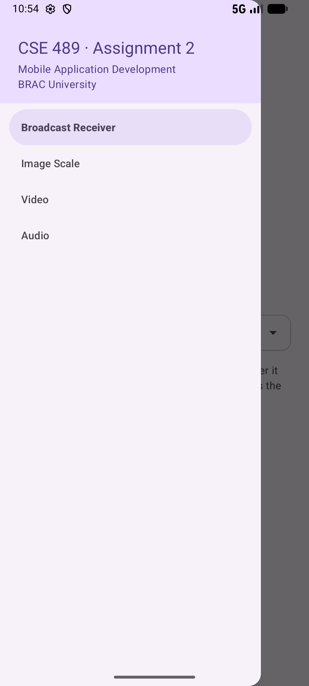<br>Navigation drawer</td>
    <td align="center">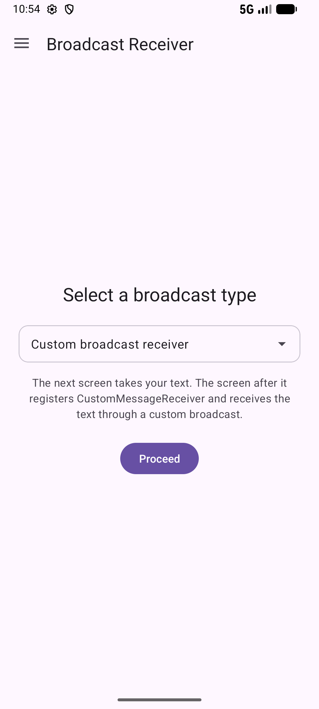<br>Broadcast Receiver (screen 1)</td>
    <td align="center">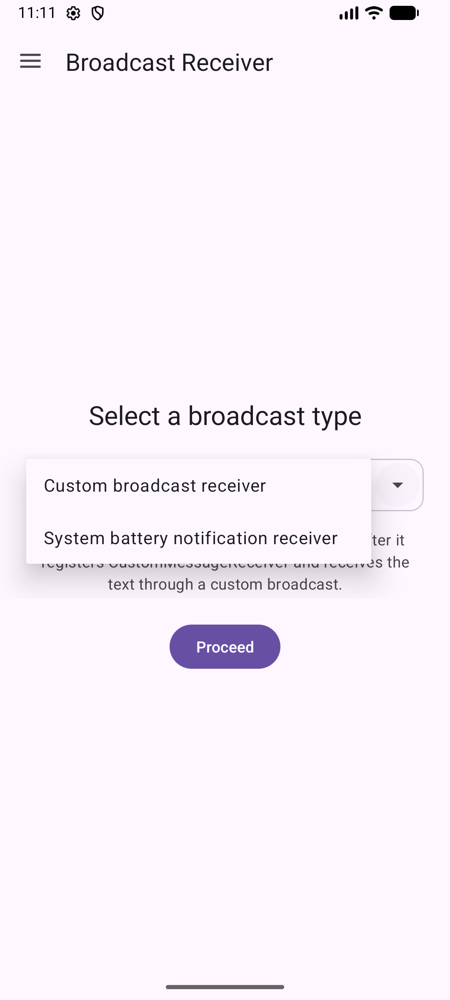<br>The two broadcast types</td>
    <td align="center">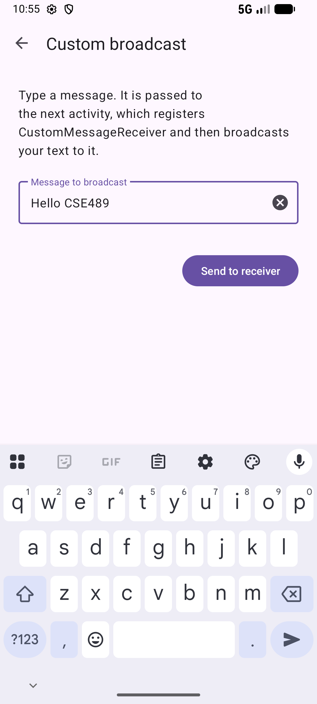<br>Activity 2: custom message</td>
  </tr>
  <tr>
    <td align="center">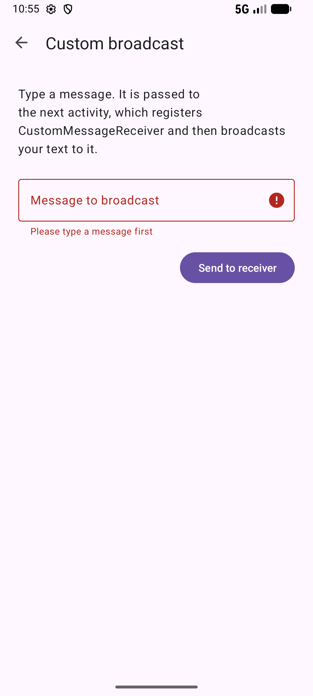<br>Blank input is rejected</td>
    <td align="center">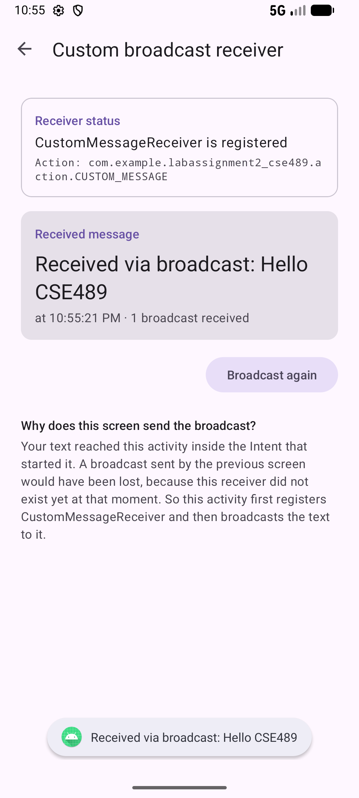<br>Activity 3: received by the custom receiver</td>
    <td align="center">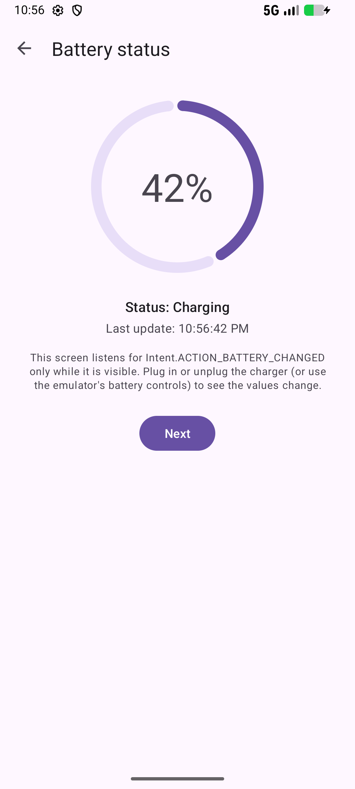<br>Activity 2: live battery level</td>
    <td align="center">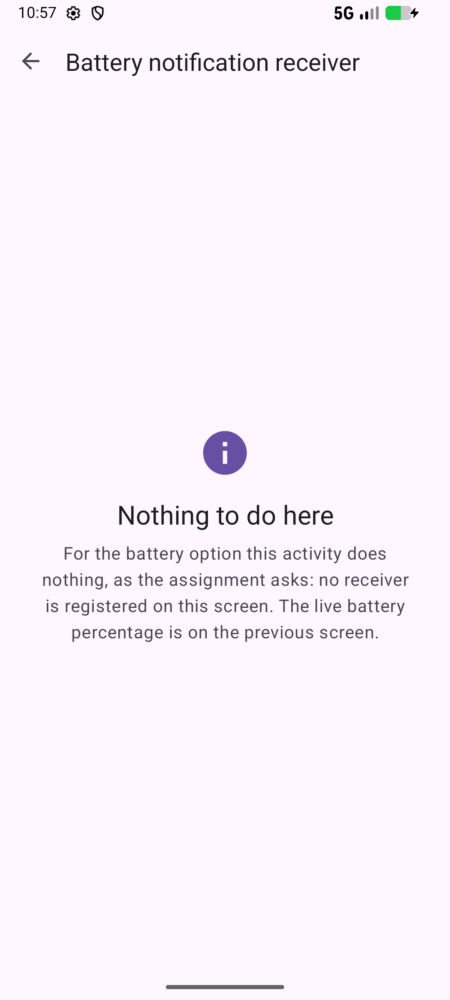<br>Activity 3: nothing to do for battery</td>
  </tr>
  <tr>
    <td align="center">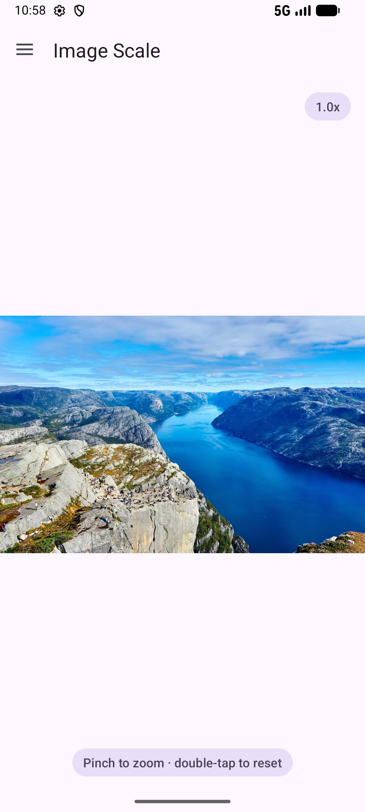<br>Image Scale (1x, fit)</td>
    <td align="center">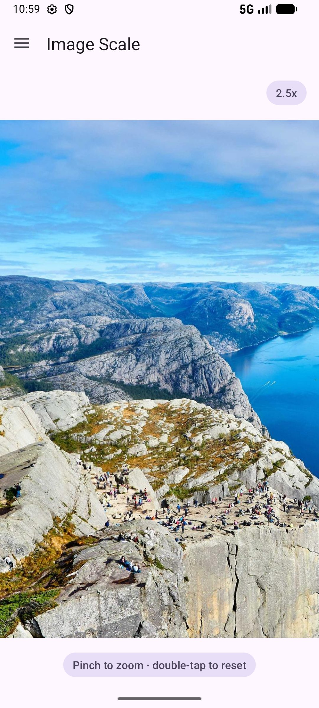<br>Zoomed in to 2.5x and panned</td>
    <td align="center">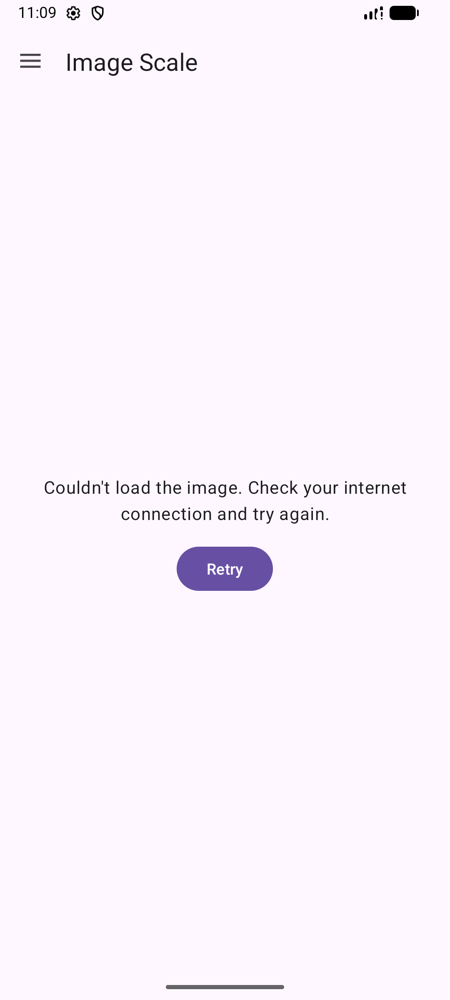<br>Offline: error with Retry</td>
    <td align="center">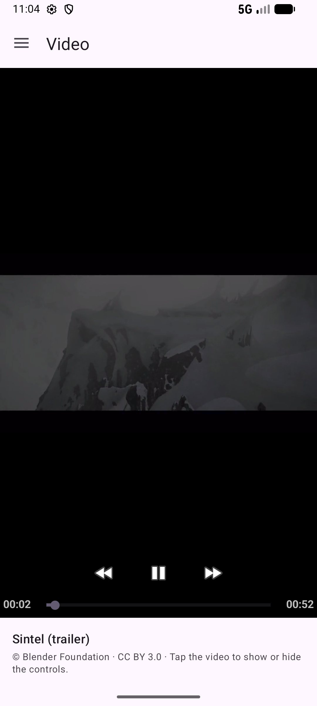<br>Video with MediaController</td>
  </tr>
  <tr>
    <td align="center">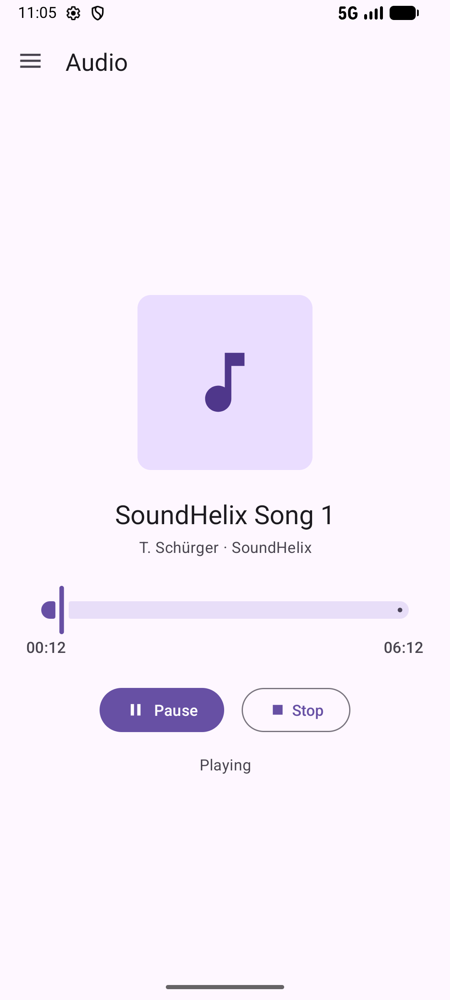<br>Audio player</td>
    <td align="center">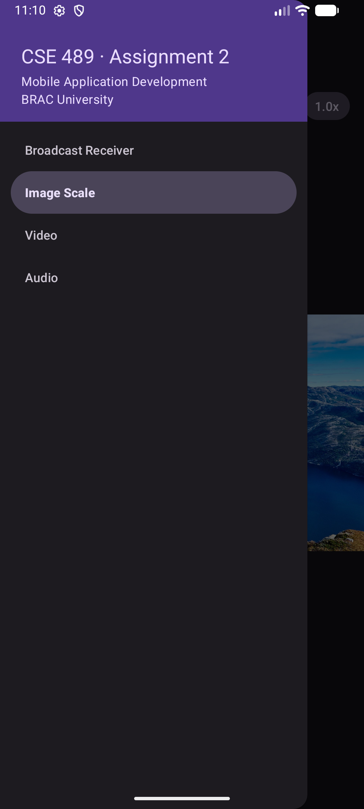<br>Dark theme: drawer</td>
    <td align="center">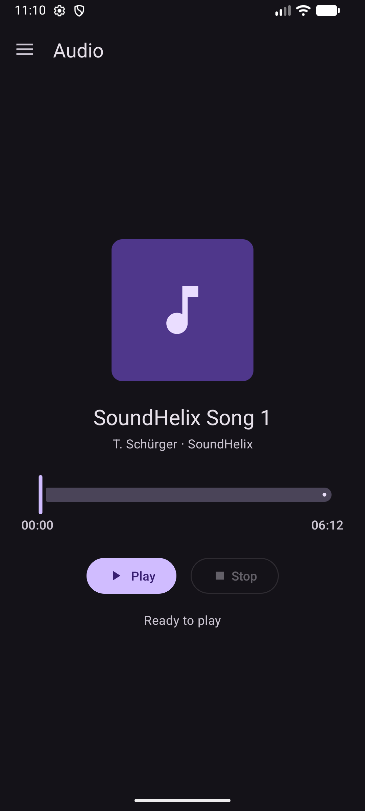<br>Dark theme: audio</td>
    <td align="center">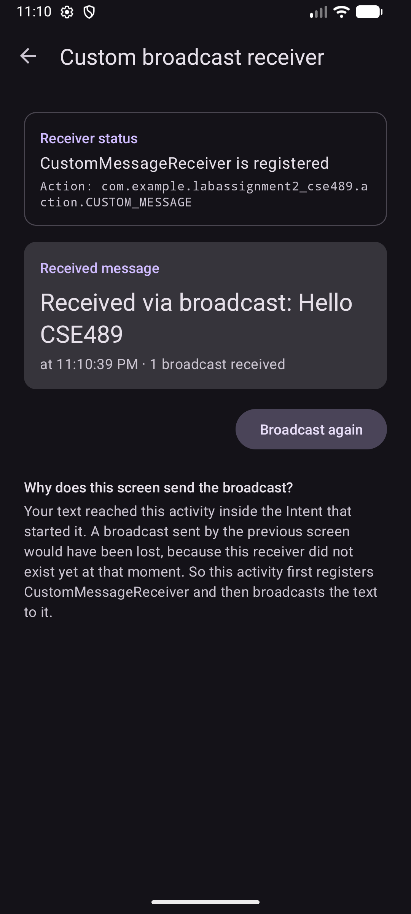<br>Dark theme: receiver</td>
  </tr>
</table>

Landscape:

<table>
  <tr>
    <td align="center">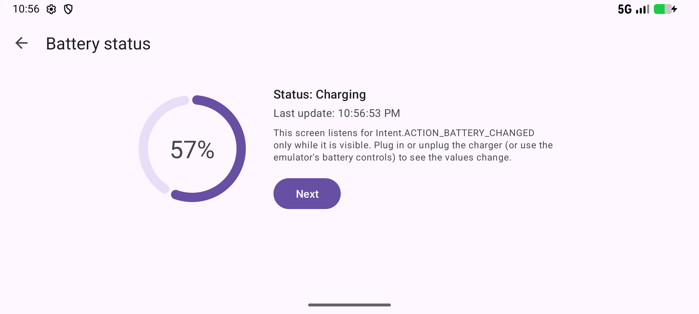<br>Battery status</td>
    <td align="center">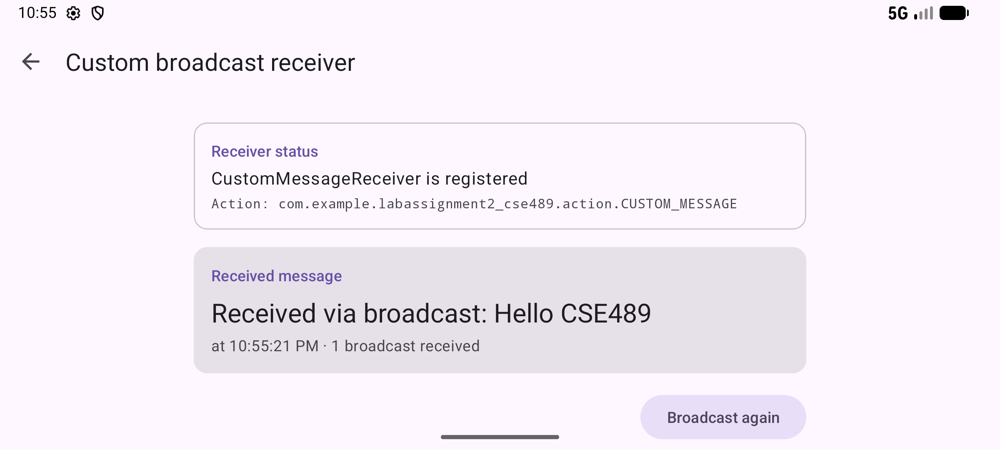<br>Custom receiver</td>
  </tr>
  <tr>
    <td align="center">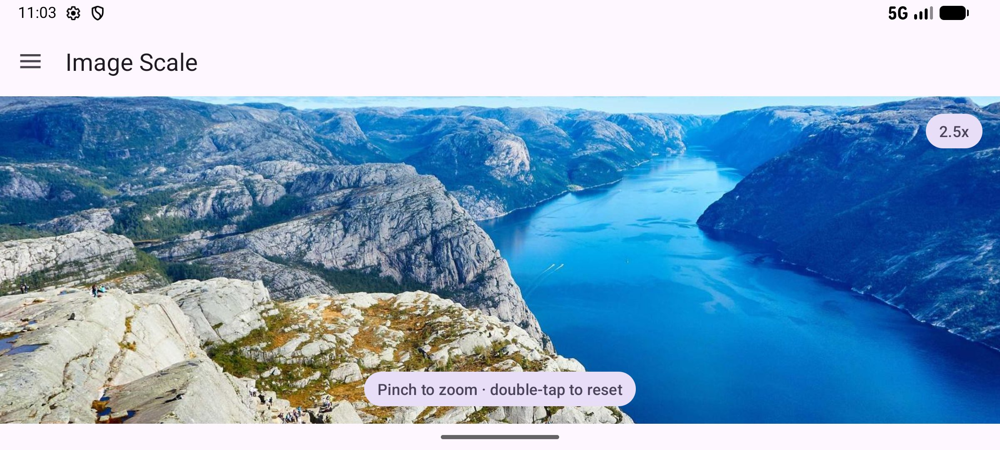<br>Image Scale (zoom kept after rotating)</td>
    <td align="center">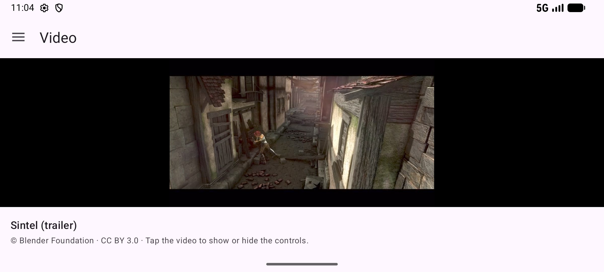<br>Video (keeps playing through rotation)</td>
  </tr>
  <tr>
    <td align="center">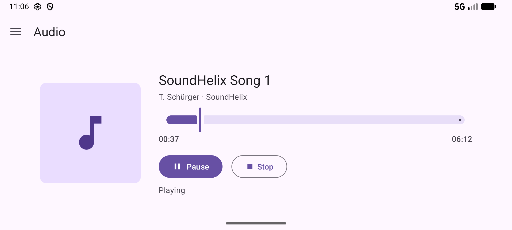<br>Audio</td>
    <td></td>
  </tr>
</table>

## Features

### A. Broadcast Receiver
- **Screen 1** (drawer destination): the label "Select a broadcast type", a Spinner fed by an
  `ArrayAdapter` from a string-array with exactly two items ("Custom broadcast receiver",
  "System battery notification receiver") and a **Proceed** button. The selection is kept in a
  `SavedStateHandle`, so it survives rotation.
- **Activity 2, custom:** a "Message to broadcast" field and a **Send to receiver** button (the
  keyboard's Send key does the same). Blank input shows an inline error. The text travels to
  Activity 3 inside the Intent.
- **Activity 2, battery:** listens for `Intent.ACTION_BATTERY_CHANGED` only while the screen is
  visible, through a `LiveData` that registers its receiver in `onActive()` and unregisters it
  in `onInactive()`. Because the broadcast is sticky, a value shows up at once. It shows a large
  percentage (`EXTRA_LEVEL * 100 / EXTRA_SCALE`, guarded against a scale of 0), a progress ring,
  the charging status and the time of the last update. **Next** opens Activity 3.
- **Activity 3, custom:** creates `CustomMessageReceiver` and registers it in `onStart()` with
  `ContextCompat.registerReceiver(..., RECEIVER_NOT_EXPORTED)`, then broadcasts the text from
  Activity 2 to it (`Intent(action).setPackage(packageName)`), and unregisters it in `onStop()`.
  The receiver shows "Received via broadcast: …" with the time, a Toast and a Log line. The
  screen also shows that the receiver is registered and for which action, and has a
  **Broadcast again** button. Rotation neither sends the broadcast again nor loses the text.
  *Why does Activity 3 send it?* A broadcast sent from Activity 2 would be lost, because
  Activity 3's receiver does not exist yet at that moment. The text therefore reaches Activity 3
  in the Intent, and Activity 3 broadcasts it once its receiver is registered.
- **Activity 3, battery:** registers nothing and just says so, as the brief asks.

### B. Image Scale
- Loads `https://picsum.photos/id/1015/2000/1300` with **Coil 3** (`coil` +
  `coil-network-okhttp`) at its **original size**, so zooming stays sharp.
- A custom `ZoomableImageView` drives an image `Matrix` with **`ScaleGestureDetector`** (no zoom
  library): zoom is anchored at the pinch focal point and clamped to 1x–5x, one finger pans
  while zoomed with the edges clamped, and double-tap zooms to 2.5x or resets. The fit is
  recomputed when the drawable or the view size changes, and the zoom survives rotation.
- Shows the current zoom ("2.5x"), the hint "Pinch to zoom · double-tap to reset", a loading
  indicator and an error state with **Retry**.

### C. Video
- `VideoView` + `MediaController` play `res/raw/sample_video.mp4` with its aspect ratio kept, a
  loading indicator until prepared, and a friendly message on errors (no system dialog).
- When the screen stops it pauses and remembers the position. After a rotation it carries on
  playing; after leaving the screen it waits, paused, at the same position.

### D. Audio
- `AudioPlayerViewModel` owns an `android.media.MediaPlayer` (`USAGE_MEDIA`), so playback
  survives rotation, and releases it in `onCleared()`.
- Play/Pause, Stop, a seekable `Slider`, elapsed/total time as mm:ss and the track title.
  Progress updates come from a coroutine while playing; the UI resets at the end of the track.
- Leaving the screen pauses the music, so **audio and video never play at the same time**.

### Platform details
- Edge-to-edge with `enableEdgeToEdge()` and window insets on every screen, in both orientations.
- Back closes an open drawer first, via `OnBackPressedDispatcher` (predictive back ready).
- Only `MainActivity` is exported; Activities 2 and 3 are started with explicit Intents.
- Rotation is handled with ViewModels and saved state (no `android:configChanges`).
- Light and dark themes (Material 3 DayNight); touch targets of at least 48dp; no hard-coded
  strings or sizes in layouts.

## Requirement → file map

Kotlin sources are under `app/src/main/java/com/example/labassignment2_cse489/`, resources
under `app/src/main/res/`.

| Requirement | Files |
|---|---|
| Drawer with four items (exact labels, order) | [`menu/drawer_menu.xml`](app/src/main/res/menu/drawer_menu.xml), [`values/strings.xml`](app/src/main/res/values/strings.xml) |
| DrawerLayout + MaterialToolbar + NavigationView + NavHostFragment | [`layout/activity_main.xml`](app/src/main/res/layout/activity_main.xml), [`MainActivity.kt`](app/src/main/java/com/example/labassignment2_cse489/MainActivity.kt) |
| Four top-level fragment destinations, start = Broadcast Receiver | [`navigation/nav_graph.xml`](app/src/main/res/navigation/nav_graph.xml) |
| Hamburger on every screen, title and highlight follow the screen | `MainActivity.setUpNavigation()` (AppBarConfiguration + NavigationUI) |
| Back closes the drawer first | `MainActivity.closeDrawerOnBack` |
| A · Screen 1: label, Spinner (2 items), Proceed | [`broadcast/BroadcastFragment.kt`](app/src/main/java/com/example/labassignment2_cse489/broadcast/BroadcastFragment.kt), [`broadcast/BroadcastViewModel.kt`](app/src/main/java/com/example/labassignment2_cse489/broadcast/BroadcastViewModel.kt), [`values/arrays.xml`](app/src/main/res/values/arrays.xml), [`layout/fragment_broadcast.xml`](app/src/main/res/layout/fragment_broadcast.xml) |
| A · The two modes | [`broadcast/BroadcastMode.kt`](app/src/main/java/com/example/labassignment2_cse489/broadcast/BroadcastMode.kt) |
| A · Activity 2 (custom input / battery) | [`broadcast/BroadcastInputActivity.kt`](app/src/main/java/com/example/labassignment2_cse489/broadcast/BroadcastInputActivity.kt), [`layout/content_custom_input.xml`](app/src/main/res/layout/content_custom_input.xml), [`layout/content_battery_status.xml`](app/src/main/res/layout/content_battery_status.xml) (+ `layout-land/`) |
| A · Battery broadcast, lifecycle-aware | [`broadcast/BatteryStatusLiveData.kt`](app/src/main/java/com/example/labassignment2_cse489/broadcast/BatteryStatusLiveData.kt), [`broadcast/BatteryViewModel.kt`](app/src/main/java/com/example/labassignment2_cse489/broadcast/BatteryViewModel.kt), [`broadcast/BatteryStatus.kt`](app/src/main/java/com/example/labassignment2_cse489/broadcast/BatteryStatus.kt) |
| A · Activity 3 + the custom receiver | [`broadcast/CustomReceiverActivity.kt`](app/src/main/java/com/example/labassignment2_cse489/broadcast/CustomReceiverActivity.kt), [`broadcast/CustomMessageReceiver.kt`](app/src/main/java/com/example/labassignment2_cse489/broadcast/CustomMessageReceiver.kt), [`broadcast/CustomReceiverViewModel.kt`](app/src/main/java/com/example/labassignment2_cse489/broadcast/CustomReceiverViewModel.kt), [`layout/content_custom_receiver.xml`](app/src/main/res/layout/content_custom_receiver.xml) |
| A · Activity 3 does nothing for battery | `CustomReceiverActivity.showNothingToDo()`, [`layout/content_battery_nothing.xml`](app/src/main/res/layout/content_battery_nothing.xml) |
| Explicit `android:exported`, only MainActivity exported; INTERNET permission | [`AndroidManifest.xml`](app/src/main/AndroidManifest.xml) |
| B · Image from the internet (Coil 3, original size) | [`image/ImageScaleViewModel.kt`](app/src/main/java/com/example/labassignment2_cse489/image/ImageScaleViewModel.kt) |
| B · Pinch zoom with ScaleGestureDetector + Matrix, pan, double-tap | [`image/ZoomableImageView.kt`](app/src/main/java/com/example/labassignment2_cse489/image/ZoomableImageView.kt), [`image/ZoomMath.kt`](app/src/main/java/com/example/labassignment2_cse489/image/ZoomMath.kt) |
| B · Zoom label, hint, loading, error + Retry | [`image/ImageScaleFragment.kt`](app/src/main/java/com/example/labassignment2_cse489/image/ImageScaleFragment.kt), [`layout/fragment_image_scale.xml`](app/src/main/res/layout/fragment_image_scale.xml) |
| C · Video with MediaController | [`video/VideoFragment.kt`](app/src/main/java/com/example/labassignment2_cse489/video/VideoFragment.kt), [`video/VideoViewModel.kt`](app/src/main/java/com/example/labassignment2_cse489/video/VideoViewModel.kt), [`layout/fragment_video.xml`](app/src/main/res/layout/fragment_video.xml), `raw/sample_video.mp4` |
| D · Audio with MediaPlayer | [`audio/AudioPlayerViewModel.kt`](app/src/main/java/com/example/labassignment2_cse489/audio/AudioPlayerViewModel.kt), [`audio/AudioFragment.kt`](app/src/main/java/com/example/labassignment2_cse489/audio/AudioFragment.kt), [`layout/fragment_audio.xml`](app/src/main/res/layout/fragment_audio.xml) (+ `layout-land/`), `raw/sample_audio.mp3` |
| Edge-to-edge window insets | [`util/WindowInsetsExt.kt`](app/src/main/java/com/example/labassignment2_cse489/util/WindowInsetsExt.kt) |
| mm:ss and clock formatting | [`util/TimeFormat.kt`](app/src/main/java/com/example/labassignment2_cse489/util/TimeFormat.kt) |
| Unit tests | [`app/src/test/`](app/src/test/java/com/example/labassignment2_cse489) |
| Instrumented (Espresso) tests | [`app/src/androidTest/`](app/src/androidTest/java/com/example/labassignment2_cse489) |

## Project structure

```
app/src/main/java/com/example/labassignment2_cse489/
├── MainActivity.kt               Drawer + toolbar + NavHostFragment, Back handling, insets
├── broadcast/
│   ├── BroadcastFragment.kt      Screen 1: Spinner + Proceed
│   ├── BroadcastViewModel.kt     Spinner selection (SavedStateHandle)
│   ├── BroadcastMode.kt          CUSTOM / BATTERY
│   ├── BroadcastInputActivity.kt Activity 2: custom text input or live battery level
│   ├── BatteryStatus.kt          Percentage maths + EXTRA_STATUS mapping
│   ├── BatteryStatusLiveData.kt  Registers the battery receiver only while observed
│   ├── BatteryViewModel.kt
│   ├── CustomReceiverActivity.kt Activity 3: registers the receiver, sends the broadcast
│   ├── CustomMessageReceiver.kt  The custom BroadcastReceiver
│   └── CustomReceiverViewModel.kt
├── image/
│   ├── ImageScaleFragment.kt     Loading / error / zoom label
│   ├── ImageScaleViewModel.kt    Coil 3 download as a StateFlow
│   ├── ZoomableImageView.kt      ScaleGestureDetector + GestureDetector + Matrix
│   └── ZoomMath.kt               Pure zoom maths (unit-tested)
├── video/
│   ├── VideoFragment.kt          VideoView + MediaController
│   └── VideoViewModel.kt         Saved position
├── audio/
│   ├── AudioFragment.kt          Controls, slider, times
│   └── AudioPlayerViewModel.kt   Owns the MediaPlayer
└── util/
    ├── TimeFormat.kt
    └── WindowInsetsExt.kt
```

## Build and run

**Requirements:** Android Studio with the Android SDK **Platform 37** installed (the app uses
`compileSdk 37`, `targetSdk 37`, `minSdk 24`), JDK 17 or newer (Android Studio's bundled JBR
works), and internet access for the first Gradle sync and for the Image Scale screen. The
video and the audio track are bundled, so those screens work offline.

**Android Studio:** *File › Open* the project folder, wait for the Gradle sync, choose an
emulator or a phone and press **Run ▶**.

**Command line (Windows, PowerShell):**

```powershell
# Only needed if Gradle cannot find a JDK:
$env:JAVA_HOME = 'C:\Program Files\Android\Android Studio\jbr'

.\gradlew.bat assembleDebug        # builds app\build\outputs\apk\debug\app-debug.apk
.\gradlew.bat installDebug         # installs it on the connected emulator/phone
```

On macOS/Linux use `./gradlew` and, if needed,
`export JAVA_HOME="/Applications/Android Studio.app/Contents/jbr/Contents/Home"`.

## How to test each feature

**Navigation drawer**
1. Tap the ☰ icon (or swipe from the left edge): the drawer lists *Broadcast Receiver, Image
   Scale, Video, Audio*.
2. Pick each item: the toolbar title changes, the item is highlighted and every screen shows ☰.
3. Open the drawer and press **Back**: the drawer closes and the app stays open.

**A. Custom broadcast**
1. *Broadcast Receiver* → keep "Custom broadcast receiver" → **Proceed**.
2. Tap **Send to receiver** with an empty field: an inline error appears.
3. Type `Hello CSE489` → **Send to receiver** (or the keyboard's Send key).
4. Activity 3 shows "CustomMessageReceiver is registered", the action name, and
   "Received via broadcast: Hello CSE489" with the time, plus a Toast. The receiver also logs:
   `adb logcat -s CustomMessageReceiver`.
5. Tap **Broadcast again** (the counter goes up). Rotate the screen: the text stays and nothing
   is sent again.

**A. Battery**
1. Choose "System battery notification receiver" → **Proceed**: the percentage, ring, status
   and "Last update" appear immediately (the battery broadcast is sticky).
2. Change the battery while the screen is open, either in the emulator's
   *Extended controls (⋯) › Battery* (charge level, charger connection, battery status) or with adb:
   ```
   adb shell dumpsys battery set level 42
   adb shell dumpsys battery set status 2      # 2 = charging, 3 = discharging, 5 = full
   adb shell dumpsys battery reset             # back to the real values
   ```
   The values update live, in portrait and landscape.
3. **Next** opens Activity 3, which only says that there is nothing to do for this option.

**B. Image Scale**
1. Open *Image Scale*: a loading indicator, then the photo at 1.0x.
2. Pinch to zoom. On the emulator, hold **Ctrl** (⌘ on macOS) and drag with the mouse. Zoom
   follows your fingers and stops at 1.0x and 5.0x.
3. Drag with one finger while zoomed: the picture pans but never shows an empty gap.
4. Double-tap: zooms to 2.5x at that point; double-tap again resets to 1.0x.
5. Rotate: the zoom level is kept. Turn off the network and clear the app's cache (or install
   fresh) to see the error state; **Retry** loads the picture once you're back online.

**C. Video**
1. Open *Video*, tap the video to show the controls, press ▶. Seek with the bar.
2. Rotate while it plays: it carries on from the same moment.
3. Switch to another drawer item and back: the video was paused and waits at the same position.

**D. Audio**
1. Open *Audio*: **Play**/**Pause**, **Stop** (rewinds), drag or tap the slider to seek; the
   times show mm:ss.
2. Rotate while playing: the music doesn't stop.
3. Switch to *Video* (or press Home): the music pauses. Audio and video never play together.

## Automated tests

```powershell
.\gradlew.bat testDebugUnitTest           # 26 JVM unit tests
.\gradlew.bat connectedDebugAndroidTest   # 18 instrumented tests (needs an emulator/phone)
.\gradlew.bat lintDebug                   # Android lint
```

- **Unit tests** (`app/src/test`): battery percentage (including scale ≤ 0 and a missing
  level), `EXTRA_STATUS` mapping, `BroadcastMode` parsing, the custom action/extra names, zoom
  clamping/fit/edge maths, and the mm:ss formatter.
- **Instrumented tests** (`app/src/androidTest`):
  - `DrawerNavigationTest`: the four labels in order, navigation to every screen (title,
    hamburger, highlighted item) and Back closing the drawer.
  - `BroadcastFlowTest`: the two Spinner items; the Custom flow end to end ("Hello CSE489"
    typed in Activity 2 is received in Activity 3, by button and by the keyboard's Send key);
    blank-input error; the battery flow.
  - `ZoomableImageViewTest`: synthetic two-finger pinches through the real
    `ScaleGestureDetector` (zoom anchored at the fingers, limited to 5x and 1x), panning with
    edge clamping, and double-tap zoom/reset.

`connectedDebugAndroidTest` uninstalls the app when it finishes, so run `installDebug` again
before a demo.

## Credits

- **Video:** *Sintel* trailer, © copyright Blender Foundation | [durian.blender.org](https://durian.blender.org),
  licensed under [CC BY 3.0](https://creativecommons.org/licenses/by/3.0/). File:
  [sintel_trailer-480p.mp4](https://download.blender.org/durian/trailer/sintel_trailer-480p.mp4)
  (H.264/AAC, 4.4 MB), bundled as `res/raw/sample_video.mp4`.
- **Audio:** *SoundHelix Song 1* by T. Schürger, generated with
  [SoundHelix](https://www.soundhelix.com/audio-examples). File:
  [SoundHelix-Song-1.mp3](https://www.soundhelix.com/examples/mp3/SoundHelix-Song-1.mp3)
  (8.9 MB), bundled as `res/raw/sample_audio.mp3`.
- **Photo:** by Alexey Topolyanskiy on [Unsplash](https://unsplash.com/photos/-oWyJoSqBRM),
  served by [Lorem Picsum](https://picsum.photos) (`/id/1015`).
- **Icons:** [Material Icons](https://fonts.google.com/icons) (Apache License 2.0).
- **Libraries:** AndroidX, Material Components for Android, [Coil 3](https://coil-kt.github.io/coil/).
